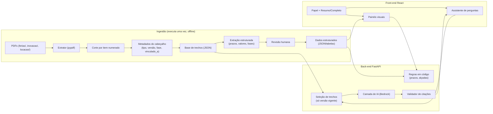

# HACKA/TS 2026 · Desafio 2 · Plataforma de Inteligência Empresarial

Documento de trabalho da equipe. Resume o que sabemos do desafio, as decisões tomadas e a arquitetura proposta para o MVP.

Legenda de confiança:
- **[Edital]** consta no regulamento lido.
- **[Acervo]** consta nos documentos que recebemos e lemos.
- **[Decisão]** combinado entre a equipe e o assistente.
- **[Proposta]** sugestão ainda não validada.
- **[A confirmar]** depende de informação que não temos.

---

## 1. O desafio

**Pergunta do desafio [Edital, item 8.1.2]:** como organizar, sintetizar e destacar as informações mais relevantes sob diferentes perspectivas de análise, por meio de recursos visuais, gráficos e interativos, transformando documentos e conteúdos complexos em inteligência empresarial, com respostas confiáveis e acesso rápido para apoiar a decisão.

**Contexto do edital:** manuais, contratos e normas internas concentram o conhecimento da empresa, mas são extensos e dispersos. Consultá-los consome tempo, exige especialistas e demanda consolidação para relatórios e apresentações executivas.

### Regras que afetam o projeto [Edital]

| Tema | Regra |
|---|---|
| Duração | 24 h seguidas, das 07h30 de 12/11/2026 às 07h30 de 13/11/2026 |
| Entrega | MVP **funcional**. Telas estáticas não contam (8.5) |
| Pitch | 5 min de apresentação + 3 min de perguntas (11.2) |
| Plano de evolução | Obrigatório no pitch: cronograma e escopo dos próximos **6 meses** (8.6) |
| Tecnologia | Sem custo para a BBTS. Preferência: Java/Node/**Python**, Angular/**React**, **PostgreSQL**, **AWS** (8.2) |
| IA | Permitida como apoio e como parte da solução, desde que a equipe explique como foi usada (8.2.5) |
| Originalidade | Código desenvolvido durante o evento. Plágio desclassifica (8.4) |
| Propriedade | Código, documentação, bases e modelos são cedidos à BBTS e entregues no ambiente indicado (15) |
| Resultado | Premiação em 13/11 às 17h |

### Critérios de avaliação, nota de 1 a 5 cada [Edital, item 10]

1. **Aderência ao desafio**
2. **Inovação**
3. **Viabilidade** (aplicação prática na BBTS)
4. **Experiência do usuário** (facilidade, acessibilidade, qualidade)
5. **Pitch**

Consequência: UX e pitch pesam 2 de 5 critérios. A demo precisa ser clara, bonita e confiável.

---

## 2. O material recebido [Acervo]

Empresa fictícia **ACME Tecnologia e Serviços**. Documentos anonimizados nas pastas `ferias/`, `inovacao/` e `locacao/`, na raiz do projeto (`/kiro`), mais o catálogo `INSTRUÇÕES SOBRE O ACERVO DE DADOS SINTÉTICOS.pdf`.

| Assunto | Documentos vigentes | Substituídos |
|---|---|---|
| Férias | NG_111 v3.0.0 (norma), PX_1111-001 (procedimento), FM_1111-001 v2.0.0 (formulário), TB_1111-001 (tabelas), FL_1111-001 (fluxograma) | NG_111 v2.0.0, FM_1111-001 v1.0.0 |
| Inovação (Ideias em Campo) | NG_1130 (norma), PX_1130-001 (funil), RG_1100 v2.0.0 (regulamento), NT_2026-021 (nota técnica de orçamento) | RG_1100 v1.0.0 (não veio na pasta) |
| Locação de coworking | CTR_2026-012 (contrato), NT_2026-018 (nota técnica) | - |

Mais um catálogo (`INSTRUÇÕES SOBRE O ACERVO DE DADOS SINTÉTICOS.pdf`) que explica as 12 categorias de documento, a numeração, as séries e lista 3 "jornadas de referência" que **não recebemos**.

**Estado da leitura:** lidos por inteiro o catálogo, a NG_111 e a NT_2026-021, e a primeira metade do RG_1100. **Ainda não lidos:** PX_1111-001, TB, FM, FL, NG_1130, PX_1130-001, CTR_2026-012 e NT_2026-018. Todos os 14 PDFs têm texto extraível.

### Armadilhas do acervo (o que a solução precisa tratar bem)

1. **Versões substituídas.** Responder pela versão vigente e saber apontar a que foi substituída.
2. **Numeração ambígua.** `PX_1111-001` liga-se à `NG_111`, e `PX_1130-001` à `NG_1130`. A fonte de verdade é o campo "Vinculado a" do cabeçalho, não o número.
3. **Lacunas legítimas.** O catálogo diz que não há resposta nas fontes sobre "mesma pessoa elaborar, revisar e aprovar". A NT_2026-021 diz que não trata de empregados afastados. A solução deve responder **"não consta"** nesses casos.
4. **Regras com cálculo.** Prazos em camadas (45, 35, 7 dias), antecipação para o dia útil anterior, 30% de ausência arredondado para baixo, faixas de alçada (R$ 18.000,00 vs R$ 18.000,01).
5. **Cruzamentos.** O orçamento da NT (R$ 96.000,00) precisa bater com os prêmios do RG (8.000 + 5.000 + 3.000 + 4 x 2.000).
6. **Exclusões.** A NG_111 (item 4.12) diz que estagiários e aprendizes não são regidos pela norma de férias.

---

## 3. Decisões tomadas [Decisão]

| # | Decisão |
|---|---|
| D1 | Back-end em **Python (FastAPI)**. Front em React. Banco PostgreSQL se necessário |
| D2 | LLM via **Amazon Bedrock**, começando pelo **Claude Haiku 4.5**. Camada de IA trocável |
| D3 | Escopo **profundo em um, simples nos outros**: **Férias** com painéis completos, **Inovação** em segundo, **Locação** enxuto. Os 3 entram no assistente e na busca |
| D4 | Toda resposta com **citação** (documento, versão, item). Quando não consta, dizer que não consta |
| D5 | Fatos vêm sempre do documento. A IA só **seleciona e reorganiza**, nunca reescreve números |
| D6 | Cálculos de data e valor em **código**, não na LLM |
| D7 | Perfis: seletor de **papel** + botão **Resumo / Completo** (ver seção 5) |

### Pontos em aberto [A confirmar]

- Se o aplicativo terá credenciais AWS no ambiente onde vai rodar (hoje só verificamos o acesso pelas ferramentas do Kiro).
- Se a banca espera perspectivas por **tipo de usuário** (cargo/nível), por **tema**, ou ambos. Pergunta sugerida ao mentor: *"Quando o desafio fala em diferentes perspectivas de análise, a expectativa é por tipo de usuário, por tema, ou ambos?"*
- Se júnior/pleno/sênior/estagiário são esperados como perfis. Os documentos só falam em **papéis** (empregado, gestor, diretor da área, GGC, GFI, NIN, proponente etc.) e em uma exclusão (estagiário).
- Onde a demo vai rodar (local ou AWS).

---

## 4. Acesso à IA: o que foi verificado

- **Verificado:** a conta AWS do ambiente (`WSParticipantRole`) lista cerca de 98 modelos de texto no Bedrock. Uma chamada de teste ao **Claude Haiku 4.5** respondeu com o identificador de perfil de inferência `us.anthropic.claude-haiku-4-5-20251001-v1:0` (região `us-east-1`). O prefixo `us.` é obrigatório.
- **Não verificado:** acesso aos demais modelos, cotas e limites, e credenciais no ambiente onde o back-end vai rodar.
- **Mentor [relato]:** a BBTS tem contrato com a AWS e usa Kiro e Copilot. O Copilot é ferramenta de desenvolvimento, não API para o produto.
- **Atenção ao custo:** o uso do Bedrock é da conta do evento. Evitar chamadas desnecessárias (cache de respostas, sem loops).

---

## 5. Arquitetura proposta [Proposta]

### Visão geral



### Camada A: trechos citáveis

Cada documento é cortado por **item numerado** (4.3.1, 4.5.2 etc.). Cada trecho guarda:

```json
{
  "documento": "NG_111",
  "titulo": "Férias",
  "versao": "3.0.0",
  "fase": "Vigente",
  "vinculado_a": null,
  "item": "4.5.3",
  "texto": "Emissão do aviso pela GGC: até 35 dias antes."
}
```

Os metadados permitem citar com precisão, excluir versões substituídas e resolver a numeração ambígua.

### Camada B: dados estruturados para os gráficos

Prazos, valores, fases e responsáveis são extraídos **uma vez** (com apoio da IA, com revisão humana) e guardados em estruturas validadas. Os gráficos leem daqui, não de uma resposta de chat. Exemplos:

- Férias: linha do tempo do pedido ao pagamento (45, 35, 7, 5 dias úteis, 3 dias), regras de fracionamento, limite de 30%.
- Inovação: 7 fases com datas, orçamento de R$ 96.000,00 por item, faixas de alçada, pontuação.
- Locação: valores, prazos e obrigações (após leitura dos documentos).

### Como a LLM é usada

1. **Responder perguntas** com citações.
2. **Sintetizar** um assunto para um papel específico.
3. **Propor** os dados da camada B (a equipe valida).

A LLM **não** faz contas de data e valor. O código calcula e a LLM explica o resultado.

**Fluxo de uma pergunta:**

1. Entrada: pergunta, papel e nível de detalhe.
2. O código seleciona os trechos relevantes (por assunto, só versão vigente).
3. Prompt: responder **somente** com base nos trechos, citar documento/versão/item, e dizer "não consta" se não houver resposta.
4. Chamada ao Bedrock.
5. O **validador** confere se cada citação existe nos trechos enviados. Se não existir, a resposta é marcada como não confiável.

### RAG ou contexto completo

O acervo tem cerca de 110 mil caracteres de texto (aproximadamente 30 mil tokens, estimativa). Isso cabe no contexto do modelo. **MVP:** filtrar por assunto e enviar tudo desse assunto, sem banco vetorial. **Evolução:** RAG com embeddings quando o acervo crescer para milhares de documentos. A decisão final depende de testar a qualidade das respostas.

### Perfis e níveis de detalhe

Dois controles independentes:

- **Papel** (vem dos documentos): Empregado, Gestor, Diretoria/Apoio, e o caso especial Estagiário/Aprendiz (exclusão do item 4.12 da NG_111). O nome "Diretoria/Apoio" agrupa diretor da área, GGC e GFI e foi criado pela equipe.
- **Detalhe:** Resumo (frase curta) ou Completo (regra, exceção e item citado).

Princípio: **uma única fonte de verdade**. Se a norma mudar de 45 para 60 dias, atualiza-se uma vez e todas as telas mudam.

### Endpoints previstos (FastAPI)

| Método | Rota | Função |
|---|---|---|
| GET | `/documentos` | Lista documentos, versões, fase (vigente/substituída) e relações |
| GET | `/assuntos/{assunto}/painel?papel=&detalhe=` | Dados estruturados para os gráficos de um assunto |
| POST | `/perguntar` | Pergunta + papel + detalhe, devolve resposta com citações |
| POST | `/ferias/calcular` | Dada uma data de início, devolve os prazos (regras em código) |
| GET | `/saude` | Verificação de funcionamento |

### Estrutura de pastas sugerida

```
/kiro
├── docs/ARQUITETURA.md
├── ferias/ inovacao/ locacao/   (PDFs originais; NÃO versionar em repositório público)
├── INSTRUÇÕES SOBRE O ACERVO DE DADOS SINTÉTICOS.pdf
├── backend/
│   ├── app/
│   │   ├── main.py
│   │   ├── ingestao/        (extração, corte, metadados)
│   │   ├── dados/           (JSON de trechos e dados estruturados)
│   │   ├── regras/          (cálculos de prazo, alçada)
│   │   ├── ia/              (cliente Bedrock, prompts, validador)
│   │   └── api/             (rotas)
│   └── tests/
└── frontend/
```

---

## 6. Divisão do time [Decisão]

| Pessoa | Foco |
|---|---|
| Front/UX | Telas, painéis, seletor de papel, interface do assistente |
| Back-end + IA (autor deste documento) | API, extração dos PDFs, camada Bedrock, prompts, validador |
| De tudo um pouco (1) | Regras em código (prazos, alçadas), dados estruturados, apoio à IA |
| Integração, testes e entrega | Integração, bateria de perguntas "armadilha", entrega à BBTS, apoio ao pitch e ao plano de 6 meses |

Observação: o back-end e a IA concentram muita coisa em uma pessoa. A extração (camada A) e a API devem ficar prontas cedo para o resto do time integrar em paralelo.

---

## 7. Cronograma proposto [Proposta]

Horários aproximados, ajustar conforme a hora real. Fim às 07h30.

| Bloco | Objetivo | Entregável |
|---|---|---|
| 1 (até ~14h) | Ler os documentos restantes, extrator, base de trechos, esqueleto da API | `/documentos` funcionando; front com layout base |
| 2 (~14h-18h) | `/perguntar` com Bedrock, citações e validação; dados estruturados de férias | Pergunta e resposta com fonte funcionando de ponta a ponta |
| 3 (~18h-22h) | Painéis de férias e inovação, seletor de papel, calculadora de prazos | **MVP funcional de ponta a ponta até ~22h** |
| 4 (~22h-02h) | Locação enxuta, bateria de perguntas armadilha, correções, exportar resumo | Qualidade das respostas validada |
| 5 (~02h-05h) | Polimento visual, revezamento de descanso, ensaio do pitch | Demo estável; roteiro do pitch e plano de 6 meses prontos |
| 6 (~05h-07h30) | Congelar código, entrega à BBTS, ensaio final | Entrega feita |

Regra: não começar funcionalidade nova depois do bloco 4.

---

## 8. Roteiro da demo (5 minutos) [Proposta]

1. O problema: documentos densos, perguntas repetidas, decisões lentas.
2. Escolher o papel (Gestor) e ver o painel de férias: linha do tempo, prazos, regras visuais.
3. Calculadora: dada uma data de início, os prazos calculados.
4. Pergunta em linguagem natural com resposta e citação clicável.
5. Pergunta sem resposta nos documentos: o sistema diz "não consta" (mostra confiança).
6. Mudar para Empregado e depois Estagiário (a norma não se aplica).
7. Inovação: orçamento em gráfico e fases do programa.
8. Fechamento com o plano de 6 meses.

---

## 9. Plano de evolução para 6 meses (esboço) [Proposta]

Exigido pelo edital (8.6). Rascunho a refinar:

- **Mês 1:** ingestão contínua de novos documentos e controle automático de versões.
- **Meses 2-3:** RAG com embeddings para escalar o acervo, integração com a fonte oficial de documentos.
- **Mês 4:** autenticação e papéis reais (integração com o diretório da empresa), trilha de auditoria.
- **Mês 5:** detecção de conflitos entre documentos e alertas de vigência a vencer.
- **Mês 6:** piloto com usuários, métricas de uso e de confiabilidade das respostas.

---

## 10. Riscos

| Risco | Mitigação |
|---|---|
| Alucinação da LLM | Prompt restritivo, validador de citações, resposta "não consta" |
| Número errado em gráfico | Camada B revisada por humano, cálculos em código |
| Credenciais AWS indisponíveis na demo | Testar cedo; plano B com resposta em cache para perguntas da demo |
| Fadiga na madrugada | MVP até ~22h, revezamento de descanso, sem funcionalidade nova após o bloco 4 |
| Tabelas e fluxograma mal extraídos | Conferir manualmente TB e FL; estruturar à mão se necessário |
| Vazamento dos documentos | Não subir os PDFs em repositório público; colocar `ferias/`, `inovacao/`, `locacao/` e o catálogo no `.gitignore` |
| Custo do Bedrock | Cache de respostas, sem chamadas em laço |
