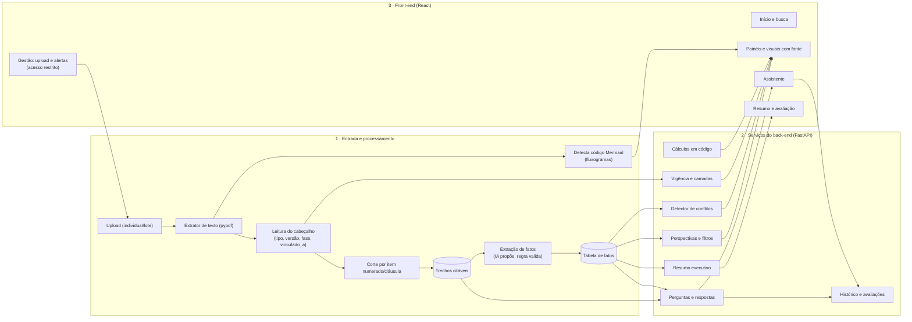

# HACKA/TS 2026 · Desafio 2 · Plataforma de Inteligência Empresarial

Documento de trabalho da equipe. Resume o que sabemos do desafio, as decisões tomadas, a priorização das funcionalidades e a arquitetura proposta para o MVP.

Legenda de confiança:
- **[Edital]** consta no regulamento lido.
- **[Slides]** consta nos slides do desafio apresentados no evento (imagens enviadas pela equipe).
- **[Acervo]** consta nos documentos recebidos e lidos.
- **[Decisão]** combinado entre a equipe e o assistente.
- **[Proposta]** sugestão ainda não validada.
- **[A confirmar]** depende de informação que não temos.

---

## 1. O desafio

**Pergunta do desafio [Edital 8.1.2, Slides]:** como organizar, sintetizar e destacar as informações mais relevantes sob diferentes perspectivas de análise, por meio de recursos visuais, gráficos e interativos, transformando documentos e conteúdos complexos em inteligência empresarial, com respostas confiáveis e acesso rápido para apoiar a decisão.

**Contexto:** manuais, contratos e normas internas concentram o conhecimento da empresa, mas são extensos e dispersos. Consultá-los consome tempo, exige especialistas e demanda consolidação para relatórios e apresentações executivas.

### Regras que afetam o projeto

| Tema | Regra |
|---|---|
| Duração | 24 h seguidas, das 07h30 de 12/11/2026 às 07h30 de 13/11/2026 [Edital] |
| Entrega | MVP **funcional**. Telas estáticas não contam (8.5) [Edital] |
| Pitch | 5 min de apresentação + 3 min de perguntas (11.2) [Edital] |
| Plano de evolução | Obrigatório no pitch: cronograma e escopo dos próximos **6 meses** (8.6) [Edital] |
| Tecnologia | Sem custo para a BBTS. Preferência: Java/Node/**Python**, Angular/**React**, **PostgreSQL**, **AWS** (8.2) [Edital]. Os slides dizem "plataforma livre, dentro das tecnologias permitidas" |
| IA | Permitida como apoio e como parte da solução, desde que a equipe explique como foi usada (8.2.5) [Edital] |
| Dados | Sintéticos [Slides] |
| Originalidade | Código desenvolvido durante o evento. Plágio desclassifica (8.4) [Edital] |
| Propriedade | Código, documentação, bases e modelos são cedidos à BBTS e entregues no ambiente indicado (15) [Edital] |
| Escopo | **"Não é preciso fazer tudo: priorize o mais crítico e viável em 24h e justifique no pitch."** [Slides] |
| Resultado | Premiação em 13/11 às 17h [Edital] |

### Critérios de avaliação, nota de 1 a 5 cada [Edital 10, Slides]

1. **Aderência ao desafio**: alinhamento com o problema.
2. **Inovação**: originalidade e diferenciação da solução.
3. **Viabilidade**: potencial de implementação na BBTS.
4. **Experiência do usuário**: usabilidade, acessibilidade e qualidade da experiência.
5. **Pitch**: clareza, objetividade e comunicação da proposta.

UX e pitch pesam 2 de 5 critérios. A demo precisa ser clara, bonita e confiável.

### As 8 funcionalidades esperadas [Slides]

| # | Funcionalidade | O que pede |
|---|---|---|
| 1 | Base e processamento de documentos | Envio e processamento de documentos individuais ou em lote, organizados por tema |
| 2 | Perguntas e respostas com fonte | Responde só com base nas fontes fornecidas, citando fonte, versão e trecho |
| 3 | Síntese e destaques | Resumo do mais relevante conforme a perspectiva: riscos, prazos, obrigações ou valores |
| 4 | Recursos visuais e interativos | Fluxograma, mapa mental, infográfico, quadro ou gráfico, **cada elemento remetendo à fonte** |
| 5 | Perspectivas de análise | Alternar a visão da mesma informação por área, tema ou prazo, com filtros |
| 6 | Resumo executivo | Resumo ou apresentação gerada a partir das informações selecionadas |
| 7 | Vigência, camadas e conflito | Indica a versão em vigor e a camada da norma; **sinaliza divergência entre fontes em vez de escolher uma** |
| 8 | Reaproveitamento e retorno | Sugere análises anteriores semelhantes e permite avaliar a resposta |

---

## 2. O material recebido [Acervo]

Empresa fictícia **ACME Tecnologia e Serviços**. Documentos anonimizados nas pastas `ferias/`, `inovacao/` e `locacao/`, na raiz do projeto (`/kiro`), mais o catálogo `INSTRUÇÕES SOBRE O ACERVO DE DADOS SINTÉTICOS.pdf`.

| Assunto | Documentos vigentes | Substituídos |
|---|---|---|
| Férias | NG_111 v3.0.0 (norma), PX_1111-001 v1.0.0 (procedimento), FM_1111-001 v2.0.0 (formulário), TB_1111-001 v1.0.0 (tabelas), FL_1111-001 v1.0.0 (fluxograma) | NG_111 v2.0.0, FM_1111-001 v1.0.0 |
| Inovação (Ideias em Campo) | NG_1130 v1.0.0 (norma), PX_1130-001 v1.0.0 (funil), RG_1100 v2.0.0 (regulamento), NT_2026-021 v1.0.0 (nota técnica de orçamento) | RG_1100 v1.0.0 (não veio na pasta) |
| Locação de coworking | CTR_2026-012 v1.0.0 (contrato), NT_2026-018 v1.0.0 (nota técnica) | - |

O catálogo explica as 12 categorias de documento, a numeração e as séries, e lista 3 "jornadas de referência" (Férias, Inovação, Locação) que **não recebemos**. Ele descreve a jornada como leitura guiada com "resumo, fluxo, ação por perfil, exemplo e perguntas frequentes". É uma pista do formato de síntese esperado.

**Estado da leitura**
- Lidos por inteiro: catálogo, NG_111, PX_1111-001, TB_1111-001, FM_1111-001 v2, FL_1111-001, NT_2026-021, NT_2026-018, CTR_2026-012.
- Lido parcialmente: RG_1100 v2 (até o Anexo E).
- Só varredura por busca de números e prazos: NG_1130 e PX_1130-001.
- Não lidos: versões substituídas (NG_111 v2, FM v1) e o restante do RG_1100.
- Todos os 14 PDFs têm texto extraível.

### Estrutura comum dos documentos [Acervo]

Todos têm um cabeçalho padronizado: tipo, título, sigla e número, versão, elaborado por, aprovado por, **fase** (Vigente), vigência ou data de aprovação e, quando existe, **Vinculado a**. Isso permite ler os metadados por regras simples, sem depender da LLM. As normas usam itens numerados (4.3.1 etc.), e contratos usam cláusulas.

O `FL_1111-001` vem como **código Mermaid** dentro do PDF, então o fluxograma pode ser desenhado diretamente no front.

### Camadas de norma [Acervo]

- O PX_1111-001 (item 2.2) diz que, em divergência, **prevalece a NG_111**. O PX_1130-001 diz o mesmo da NG_1130.
- Hierarquia observada: **NG** manda; **PX** detalha; **FM, TB e FL** apoiam. **RG** (regulamento de programa) se liga à NG e **NT e CTR** (instrumentos) têm numeração própria e referenciam outras normas.
- Alçadas (R$ 18.000,00 e R$ 120.000,00) vêm da **NG_012**, citada em três documentos, mas a NG_012 **não está no acervo** [A confirmar].

### Armadilhas do acervo (o que a solução precisa tratar bem)

1. **Versões substituídas.** Responder pela versão vigente e saber apontar a que foi substituída. Exemplos: o FM v1 pedia 30 dias de antecedência e o v2 pede 45; o RG v1 permitia 3 ideias e o v2 permite 2. Isso é mudança de versão, não conflito.
2. **Numeração ambígua.** `PX_1111-001` liga-se à `NG_111`, e `PX_1130-001` à `NG_1130`. A fonte de verdade é o campo "Vinculado a".
3. **Lacunas legítimas.** O catálogo diz que não há resposta nas fontes sobre "mesma pessoa elaborar, revisar e aprovar". A NT_2026-021 diz que não trata de empregados afastados. A solução deve responder **"não consta"**.
4. **Regras com cálculo.** Prazos em camadas, antecipação para o dia útil anterior, 30% de ausência arredondado para baixo (TB Tabela 4), faixas de alçada (R$ 18.000,00 vs R$ 18.000,01), multa de 5% de R$ 18.250,00 (R$ 912,50).
5. **Cruzamentos.** O orçamento da NT_2026-021 (R$ 96.000,00) precisa bater com os prêmios do RG_1100. O valor do coworking (R$ 18.250,00) cai na faixa de diretor, igual nos dois documentos de locação.
6. **Exclusões.** A NG_111 (item 4.12) diz que estagiários e aprendizes não são regidos pela norma de férias.
7. **Conflitos entre fontes.** Nos números conferidos entre documentos vigentes (prazos de férias, alçadas, valores de coworking e orçamento) **não encontrei contradição**. A comparação não foi completa. A detecção deve ser automática e a varredura sistemática ainda precisa ser feita.

---

## 3. Decisões tomadas [Decisão]

| # | Decisão |
|---|---|
| D1 | Back-end em **Python (FastAPI)**. Front em React. Armazenamento em PostgreSQL (ou SQLite no início, se o time preferir simplicidade) |
| D2 | LLM via **Amazon Bedrock**, começando pelo **Claude Haiku 4.5**. Camada de IA trocável |
| D3 | Escopo **profundo em um, simples nos outros**: Férias aprofundado, Inovação em segundo, Locação enxuto |
| D4 | Toda resposta com **citação** (documento, versão, item e trecho). Quando não consta, dizer que não consta |
| D5 | Fatos vêm sempre do documento. A IA só **seleciona e reorganiza**, nunca reescreve números |
| D6 | Cálculos de data e valor em **código**, não na LLM |
| D7 | **Perspectivas** por tema e prazo, com filtro por área. Papel do usuário vira uma seção do guia ("ação por perfil") |
| D8 | **Tabela de fatos** como peça central da arquitetura (seção 5) |
| D9 | **Priorizar** as 8 funcionalidades em níveis (seção 4), e justificar no pitch o que fica de fora |
| D10 | **Dois modos de operação:** com IA e **sem IA (extrativo)**. A demo precisa funcionar localmente mesmo se o serviço de IA falhar ou o acesso à AWS estiver pendente (seção 5, "Modos de operação") |
| D11 | **Busca de trechos em PostgreSQL** (full-text search em português), com alternativa de SQLite ou busca em memória se a instalação consumir tempo |
| D12 | Toda citação inclui **documento, versão, página e trecho**. Se a busca só sustenta parte da resposta, a interface mostra o que ficou **sem confirmação** |
| D13 | **Duas áreas separadas:** *Consulta* (quem pergunta e entende) e *Gestão* (quem sobe documentos e confere versões e alertas). Upload e conflitos saem do caminho de quem consulta (seção 5, "Áreas, acesso e segurança") |
| D14 | **Sem tela de login nem de cadastro. A identidade vem do SSO da empresa** (login único transparente): o funcionário já está autenticado no computador, e a aplicação recebe a identidade do provedor de identidade da empresa. O **perfil vem dos grupos** da conta e define a **visão inicial**. O seletor **"Ver para"** continua, para quem quer a visão de outro papel (por exemplo, um gestor consultando as regras de estagiários). A *Gestão* só aceita o perfil de gestão. No MVP, como não há provedor de identidade real, um **simulador de SSO** com usuários de teste entrega a identidade pelo mesmo caminho, claramente identificado como simulação |
| D15 | **Interface simples para quem consulta:** resposta primeiro, fonte logo abaixo, jornada em 5 passos no lugar do fluxograma, detalhes só quando a pessoa pede. O fluxograma completo fica atrás de um link técnico |

### Pontos em aberto [A confirmar]

- Se o aplicativo terá credenciais AWS no ambiente onde vai rodar (hoje só verificamos o acesso pelas ferramentas do Kiro).
- Onde a demo vai rodar (local ou AWS).
- Se existem as 3 jornadas de referência citadas no catálogo.
- Se a NG_012 (alçadas) está disponível.
- Se existe algum conflito intencional entre documentos (depende da varredura).
- Nome do produto: as telas atuais usam **"IPBOT"**, nome citado em um texto da equipe. Versões anteriores das telas usavam "Clara" como nome provisório. Confirmar o nome definitivo.
- Se o PostgreSQL pode ser instalado e rodar localmente nos notebooks, ou se é melhor usar a alternativa leve.
- Qual provedor de identidade a BBTS usa e como a aplicação receberia a identidade (padrões comuns: OIDC ou SAML). Sem isso, o MVP usa o simulador de SSO (D14). Não verifiquei se a conta do evento oferece algum serviço de login da AWS (como o Cognito) para federar com o provedor da empresa, e não é necessário para a demo.
- Se a organização espera que alguns documentos sejam restritos por cargo ou nível. Hoje assumimos que não (seção 5, "Áreas, acesso e segurança"). Pergunta ao mentor pendente.

---

## 4. Priorização das funcionalidades [Proposta]

Não vamos implementar as 8 com a mesma profundidade. O slide permite priorizar, desde que seja justificado.

### Nível 1 · Núcleo (precisa funcionar na demo)

| # | Funcionalidade | Entrega mínima |
|---|---|---|
| 1 | Base e processamento | Na área de **Gestão**: upload (individual e em lote) de PDFs no formato do acervo; leitura do cabeçalho; organização por tema; lista de documentos com versão e fase |
| 2 | Perguntas com fonte | Resposta com documento, versão, **página**, item e trecho; "não consta" quando não houver; indicação do que ficou **sem confirmação**; validador de citações; funciona **com e sem IA** |
| 3 + 5 | Destaques e perspectivas | Seletor de perspectiva (Prazos, Valores, Obrigações, Riscos) e filtros por assunto e área, alimentados pela tabela de fatos |
| 4 | Visuais com fonte | **Jornada em 5 passos** como visual principal, gráfico de orçamento e linha do tempo; cada elemento abre o item de origem. O fluxograma completo (`FL_1111-001`) fica atrás de um link técnico |
| 7 | Vigência, camadas, conflito | Selo de versão em vigor, aviso de versão substituída, camada da norma (NG > PX > apoio) e alerta quando duas fontes divergem |

### Nível 2 · Barato, se o núcleo estiver estável

| # | Funcionalidade | Entrega mínima |
|---|---|---|
| 6 | Resumo executivo | O usuário marca fatos e gera uma página (Markdown/HTML para PDF) com as fontes. Reaproveita a tabela de fatos |
| 8 | Reaproveitamento e retorno | Botão "ajudou?" com comentário, histórico das perguntas e sugestão de perguntas parecidas por similaridade simples de palavras |

### Nível 3 · Plano de 6 meses (não entra no MVP)

- Mapa mental interativo completo.
- Exportação em apresentação (PowerPoint).
- Similaridade semântica com embeddings e aprendizado a partir das avaliações.
- Integração com a fonte oficial de documentos.

### Como justificar no pitch

"Priorizamos o que gera confiança e decisão: documentos processados, respostas com fonte, perspectivas e conflito entre fontes. Resumo executivo e retorno do usuário entram como extensão da mesma base de fatos. Mapa mental e apresentação ficam para o plano de 6 meses, porque dependem da mesma base e não mudam o valor central."

---

## 5. Arquitetura proposta [Proposta]

### Visão geral



### Camada A · Trechos citáveis

Cada documento é cortado por **item numerado** ou **cláusula**. Cada trecho guarda:

```json
{
  "documento": "NG_111",
  "titulo": "Férias",
  "tipo": "NG",
  "versao": "3.0.0",
  "fase": "Vigente",
  "vinculado_a": null,
  "pagina": 3,
  "item": "4.5.3",
  "texto": "Emissão do aviso pela GGC: até 35 dias antes."
}
```

A página 3 do item 4.5.3 foi conferida no PDF da NG_111 v3.0.0. O `pypdf` extrai o texto página a página, então a página é guardada na ingestão e entra em toda citação.

### Camada B · Tabela de fatos (peça central)

Cada informação relevante vira um registro com categoria, área e fonte. Esta tabela alimenta perspectivas, destaques, gráficos, resumo e detecção de conflito. É construída uma vez e usada em todo lugar.

```json
{
  "id": "fato-0042",
  "categoria": "prazo",
  "assunto": "ferias",
  "area": "GGC",
  "atributo": "emissao_do_aviso",
  "descricao": "Emitir o aviso de férias",
  "valor": 35,
  "unidade": "dias antes do início",
  "documento": "NG_111", "versao": "3.0.0", "pagina": 3, "item": "4.5.3",
  "trecho": "Emissão do aviso pela GGC: até 35 dias antes.",
  "vigente": true
}
```

- `categoria` ∈ **prazo, valor, obrigação, risco** (as perspectivas pedidas nos slides).
- `area` = unidade responsável (GGC, GFI, NIN, GCO, GOC, DIRAF etc.).
- `atributo` normalizado permite comparar o mesmo fato entre fontes.
- A IA **propõe** os fatos, uma regra valida o formato, e uma pessoa **revisa** os do assunto aprofundado (Férias).

### Detecção de vigência, camadas e conflito (funcionalidade 7)

1. **Vigência:** vem da fase e da vigência do cabeçalho. Versões substituídas ficam marcadas e fora das respostas, mas visíveis na tela de versões.
2. **Camada:** NG > PX > FM/TB/FL. Quando um PX e uma NG dizem coisas diferentes, o sistema informa que a NG prevalece (regra do próprio acervo).
3. **Conflito:** para cada `assunto + atributo`, compara os valores entre fontes **vigentes**:
   - Mesmo valor: tudo certo.
   - Valores diferentes entre fontes de camadas diferentes: avisa a divergência e indica qual camada prevalece, **mostrando as duas fontes**.
   - Valores diferentes entre fontes de mesma camada, ou camada indefinida: marca como **conflito sem resolução** e não escolhe uma.
   - Diferença só entre versões (ex.: 30 para 45 dias): mostra como "mudou na versão", não como conflito.
4. **Viabilidade entre regras (verificação local):** além de comparar o mesmo fato entre fontes, o código cruza regras verificáveis entre si. Exemplo: um prazo de 5 dias é impossível se uma aprovação obrigatória só pode ocorrer a partir do 7º dia. Funciona com prazos, valores e faixas já estruturados na tabela de fatos, sem LLM. Não resolve expressões ambíguas nem papéis descritos de formas diferentes; isso depende da análise semântica do modo com IA.

### Como a LLM é usada

1. **Responder perguntas** com citações.
2. **Propor fatos** para a tabela (com revisão).
3. **Sintetizar** o resumo executivo a partir dos fatos selecionados.

A LLM **não** faz contas de data e valor. O código calcula e a LLM explica o resultado.

**Fluxo de uma pergunta:**
1. Entrada: pergunta, perspectiva e filtros.
2. O código seleciona fatos e trechos relevantes (só versão vigente).
3. Prompt: responder **somente** com base nos trechos, citar documento/versão/item e dizer "não consta" se não houver resposta.
4. Chamada ao Bedrock.
5. O **validador** confere se cada citação existe nos trechos enviados. Se não existir, a resposta é marcada como não confiável.
6. A pergunta, a resposta e a avaliação do usuário são salvas no histórico.

### Modos de operação [Decisão D10]

A aplicação continua aceitando perguntas mesmo se o modelo de IA estiver indisponível. A demo precisa funcionar localmente.

| | Modo com IA | Modo sem IA (extrativo) |
|---|---|---|
| Como responde | A LLM escreve a resposta usando só os trechos recuperados | A aplicação mostra as passagens relevantes, sem texto gerado |
| Evidência | Documento, versão, página e trecho | A mesma |
| Cobertura parcial | Indica o que ficou sem confirmação | A mesma |
| Regras verificáveis (prazos, valores, alçadas, conflitos, viabilidade) | Rodam em código | Rodam em código |
| Perda | - | A pessoa pode precisar ler mais de um trecho para chegar à conclusão. Casos com expressões ambíguas ou papéis descritos de formas diferentes perdem a análise semântica complementar |

- O sistema escolhe o modo automaticamente: se a chamada ao Bedrock falhar ou expirar, cai para o modo sem IA e avisa a pessoa na tela.
- Nos dois modos a pessoa abre a **mesma evidência** e confere de onde veio a conclusão.
- A geração opcional melhora a fluidez e ajuda nos casos mais abertos. Ela nunca é necessária para ver a fonte.
- Os gráficos, o fluxograma, os filtros, o detector de conflitos e os cálculos **não dependem da IA**.

### Busca de trechos [Decisão D11]

- **PostgreSQL** com busca de texto em português (`tsvector`/`tsquery`, configuração `portuguese`) sobre os trechos, filtrada pelo **tema** selecionado e por versões vigentes. O PostgreSQL é uma das tecnologias recomendadas no edital (8.2.3).
- **Alternativa se a instalação consumir tempo:** SQLite com FTS5, ou busca em memória (BM25) em Python. A interface de busca fica isolada para trocar sem refazer o resto.
- O resultado é uma lista ordenada de passagens com documento, versão, página, item e trecho.
- **Confirmação parcial:** o sistema compara o que a pergunta pede com o que os trechos sustentam. O que não tiver apoio é marcado como **"sem confirmação"**, e não preenchido por suposição. Se nada sustentar, a resposta é "não consta".
- No modo com IA, os trechos recuperados são enviados à LLM, e o validador confere cada citação.

### RAG ou contexto completo

O acervo tem cerca de 110 mil caracteres (aproximadamente 30 mil tokens, estimativa). Cabe no contexto do modelo. **MVP:** a busca acima seleciona os trechos, e no modo com IA eles vão para a LLM. **Evolução:** RAG com embeddings quando o acervo crescer. A decisão final depende de testar a qualidade das respostas.

### Upload (funcionalidade 1) [Proposta]

- O cabeçalho dos documentos do acervo é padronizado, então o tipo, a versão, a fase e o vínculo são lidos por **regras**, sem LLM.
- O **tema** vem da norma vinculada e da série numérica (por exemplo, NG_111 e PX_1111-001 pertencem a Férias).
- Para documentos fora do padrão, a LLM tenta classificar, e o usuário confirma.
- Processamento em segundo plano, com indicação de progresso por documento.

### Áreas, acesso e segurança [Decisão D13, D14, D15]

**Duas áreas, dois públicos:**

| | Consulta | Gestão |
|---|---|---|
| Quem usa | Funcionários que querem perguntar e entender | Quem mantém o acervo |
| Telas | Início, Resposta, Guia do assunto (jornada), Resumo | Documentos (upload em lote, versões, situação) e Alertas |
| Vê versões e conflitos? | Só o selo "Em vigor, versão X" e o link para versões anteriores; aviso curto quando duas fontes divergem | Lista completa de versões, mudanças entre versões e divergências entre fontes |
| Acesso | Identidade vinda do SSO, sem tela de login; perfis empregado ou gestor | Identidade vinda do SSO, com o perfil de gestão do acervo |

**Segurança [Decisão D14]:**

- Os documentos do acervo trazem "#interna" no cabeçalho e a nota técnica de coworking classifica a informação do contrato como "Uso interno" [Acervo]. Em uso real, o acesso seria restrito a funcionários.
- **Cadastro próprio** (criar conta, guardar usuários e senhas) não entra: dá trabalho, é fácil de fazer errado e não agrega valor à demo.
- **Fluxo com SSO (alvo):** o funcionário abre a aplicação → é levado ao provedor de identidade da empresa, onde já está autenticado → o provedor devolve um **token assinado** com nome e grupos → o back-end **valida** o token (assinatura, emissor, público e validade) → converte os grupos em perfil (`empregado`, `gestor`, `gestao`, entre outros) por uma **tabela configurável de grupo → perfil** → abre uma sessão curta. A aplicação não guarda senha nenhuma.
- **Regra de segurança:** o back-end **nunca confia em identidade que venha do navegador** (nome, perfil ou cabeçalho enviados pelo cliente). Só aceita o token validado. Todas as rotas recusam chamadas sem sessão, e as de upload e alertas recusam quem não tem o perfil `gestao`.
- **MVP:** não há provedor de identidade real. Um **simulador de SSO** (ligado só em ambiente de demonstração, por uma configuração) emite o mesmo tipo de token assinado para três usuários de teste (empregado, gestor, gestão do acervo). O resto da aplicação não sabe a diferença. Chaves de assinatura e usuários de teste ficam em variáveis de ambiente, fora do repositório.
- **Limite do MVP, dito com clareza:** o simulador identifica a pessoa na demo, mas **não é segurança de verdade**. A tela do simulador avisa isso.
- **Evolução:** trocar o simulador pelo SSO real da empresa. É a troca de uma peça: o resto fica igual. Consta no plano da seção 9, no mesmo item que já existia.
- O perfil vem da conta e define a visão inicial: o guia destaca os passos da pessoa (por exemplo, "Você (gestor)" no passo de decisão). Ele também define o acesso à Gestão e o histórico da pessoa.
- O seletor **"Ver para"** troca só a **visão** (papel cujas regras aparecem). Não muda o que a pessoa tem permissão de acessar. O acervo não define regras de acesso por cargo: os documentos trazem só "#interna" ou "Uso interno" [Acervo]. No MVP, **todos os perfis veem todos os documentos**, e o "Ver para" é só apresentação. Isso é uma **suposição**, não uma regra confirmada. Se a organização informar que há documentos restritos por nível, a permissão passa a ser conferida no **back-end, na busca**, antes de mostrar o trecho ou enviá-lo à IA (esconder só na tela não basta). Essa hierarquia fica fora do MVP.

**Interface da Consulta [Decisão D15]:** a resposta vem primeiro, a fonte aparece logo abaixo (a primeira já aberta), e cada passo da jornada abre uma explicação curta com a regra, a página e o item. Não há indicador permanente de modo (com IA ou sem IA): se a IA cair, aparece um aviso curto na hora. As perspectivas (Prazos, Valores, Obrigações, Riscos) são abas discretas, e o filtro por área fica escondido.

**Telas desenhadas (rascunhos, versão 3):** Simulador de SSO (só demonstração). Consulta: Início, Resposta, Guia do assunto (visão do gestor), Valores (Ideias em Campo) e Aviso de divergência (com valores de exemplo). Gestão: Documentos e Alertas. A tela de Resumo foi desenhada na versão anterior e não mudou.

### Perspectivas e papéis [Decisão D7]

- **Controle principal:** perspectiva (Prazos, Valores, Obrigações, Riscos) + filtros por assunto e área.
- **Seção "ação por perfil"** dentro do guia de cada assunto: Empregado, Gestor, Diretoria/Apoio e o caso especial Estagiário/Aprendiz (exclusão do item 4.12 da NG_111). Os nomes "Diretoria/Apoio" e a divisão por perfil são criação da equipe, a partir dos papéis que os documentos descrevem.
- **Nível de detalhe:** Resumo ou Completo.
- **Visão inicial vs. "Ver para":** a visão inicial vem do perfil da conta. O seletor "Ver para" (Empregado, Gestor, Diretoria ou apoio, Estagiário ou aprendiz) deixa a pessoa olhar o assunto pela ótica de outro papel, com um link "Voltar à minha visão". A visão escolhida vai como parâmetro nas chamadas ao back-end.
- **Escopo:** o sistema responde sobre **normas**, não sobre **dados de pessoas** (como o caso de um estagiário específico). Pergunta sobre uma pessoa não é atendida.
- **Visão sem norma própria:** para Estagiário ou aprendiz, o acervo só tem o item 4.12 da NG_111 (a norma de férias não se aplica a eles). A tela mostra esse item e diz que não há outra norma no acervo, em vez de inventar regras.
- Princípio: **uma única fonte de verdade**. Se a norma mudar, atualiza-se uma vez e todas as telas mudam.

### Endpoints previstos (FastAPI)

| Método | Rota | Função |
|---|---|---|
| POST | `/documentos` | **Gestão (exige perfil `gestao`).** Upload (individual ou em lote) e disparo do processamento |
| GET | `/documentos` | Lista documentos, versões, fase, tema e relações |
| GET | `/fatos?categoria=&assunto=&area=` | Fatos para perspectivas, filtros e gráficos |
| GET | `/assuntos/{assunto}/fluxo` | Código Mermaid do fluxograma, com ligação de cada nó à fonte |
| GET | `/conflitos?assunto=` | Divergências e mudanças de versão. Alimenta os alertas da **Gestão (exige perfil `gestao`)**; a Consulta recebe só o selo de versão e o aviso curto de divergência |
| POST | `/perguntar` | Pergunta + perspectiva + filtros. Devolve o modo usado (`com_ia` ou `sem_ia`), a resposta (quando houver), as passagens com documento, versão, página e trecho, e a lista do que ficou sem confirmação |
| GET | `/ia/status` | Informa se o modelo de IA está disponível; a Consulta só mostra um aviso curto quando a IA cai (D15) |
| GET | `/auth/callback` | Recebe o token do provedor de identidade, valida (assinatura, emissor, público e validade), converte grupos em perfil e abre a sessão (D14) |
| GET | `/eu` | Nome e perfil da pessoa identificada; a interface usa para personalizar o guia e mostrar ou esconder a Gestão |
| GET | `/sso/simulador` | **Somente demonstração** (ligado por configuração). Simula o provedor de identidade com três usuários de teste |
| POST | `/resumo-executivo` | Gera resumo a partir dos fatos escolhidos |
| POST | `/feedback` | Avaliação e comentário sobre uma resposta |
| GET | `/analises/similares?q=` | Perguntas e análises anteriores parecidas |
| POST | `/ferias/calcular` | Dada uma data de início, devolve os prazos (regras em código) |
| GET | `/saude` | Verificação de funcionamento |

### Estrutura de pastas sugerida

```
/kiro
├── docs/ARQUITETURA.md
├── ferias/ inovacao/ locacao/   (PDFs originais; NÃO versionar em repositório público)
├── INSTRUÇÕES SOBRE O ACERVO DE DADOS SINTÉTICOS.pdf
├── backend/
│   ├── app/
│   │   ├── main.py
│   │   ├── ingestao/        (extração, cabeçalho, corte, Mermaid)
│   │   ├── fatos/           (extração, validação, tabela de fatos)
│   │   ├── regras/          (cálculos de prazo, alçada; conflitos e camadas)
│   │   ├── ia/              (cliente Bedrock, prompts, validador)
│   │   ├── resumo/          (resumo executivo)
│   │   └── api/             (rotas)
│   └── tests/               (perguntas "armadilha")
└── frontend/
    ├── sso-simulador/       (somente demonstração; simula o provedor de identidade)
    ├── consulta/            (Início, Resposta, Guia, Valores, Resumo)
    └── gestao/              (Documentos e Alertas; acesso restrito)
```

---

## 6. Divisão do time [Decisão]

| Pessoa | Foco |
|---|---|
| Front/UX | Telas, painéis, perspectivas, fluxograma, interface do assistente |
| Back-end + IA (autor deste documento) | API, upload, extração, Bedrock, prompts, validador, detector de conflitos |
| De tudo um pouco (1) | Tabela de fatos (curadoria e revisão), regras em código (prazos, alçadas) |
| Integração, testes e entrega | Integração, bateria de perguntas "armadilha", resumo executivo, entrega à BBTS, apoio ao pitch e ao plano de 6 meses |

Observação: o back-end e a IA concentram muita coisa em uma pessoa. A extração (camadas A e B) e a API devem ficar prontas cedo para o resto do time integrar em paralelo.

---

## 7. Cronograma proposto [Proposta]

Horários aproximados, ajustar à hora real. Fim às 07h30.

| Bloco | Objetivo | Entregável |
|---|---|---|
| 1 (até ~14h) | Ler documentos restantes; extrator; leitura de cabeçalho; esqueleto da API; layout base do front | `/documentos` com tipo, versão e fase; primeiros trechos |
| 2 (~14h-18h) | **Busca de trechos e modo sem IA primeiro**, depois Bedrock e validador; **tabela de fatos** (Férias primeiro); upload | Pergunta com passagens e página funcionando sem IA; com IA como camada adicional; fatos de Férias revisados |
| 3 (~18h-22h) | Perspectivas e filtros; fluxograma e linha do tempo com fonte; vigência e camadas; fatos de Inovação | **MVP de ponta a ponta até ~22h** (funcionalidades 1, 2, 3, 4, 5 e 7) |
| 4 (~22h-02h) | Detector de conflitos; Locação enxuto; bateria de perguntas armadilha; resumo executivo e feedback (nível 2) | Qualidade validada; nível 2 se couber |
| 5 (~02h-05h) | Polimento visual, revezamento de descanso, ensaio do pitch | Demo estável; pitch e plano de 6 meses prontos |
| 6 (~05h-07h30) | Congelar código, entrega à BBTS, ensaio final | Entrega feita |

Regra: não começar funcionalidade nova depois do bloco 4.

---

## 8. Roteiro da demo (5 minutos) [Proposta]

1. O problema: documentos densos, perguntas repetidas, decisões lentas (15 s).
2. **Gestão:** upload em lote dos documentos, que aparecem organizados por tema, com versão e situação (30 s). Depois, volta para a Consulta.
3. **Perspectiva "Prazos"** em Férias: fluxograma e linha do tempo; clicar num elemento abre o item da norma (60 s).
4. **Pergunta** em linguagem natural com resposta, versão, página e trecho (45 s). Se a IA estiver fora do ar, a demo continua com as passagens e mostra o aviso de modo sem IA.
5. **Pergunta sem resposta**: o sistema diz "não consta" (20 s).
6. **Vigência e conflito**: na Consulta, o selo "Em vigor" e o aviso curto; na Gestão, os alertas com a mudança entre versões e as divergências entre fontes (45 s).
7. **Troca de perspectiva** para Valores em Inovação e Locação: orçamento e alçadas (45 s).
8. **Resumo executivo** gerado com as fontes e **avaliação** da resposta (30 s), se estiver pronto.
9. Plano de 6 meses (30 s).

---

## 9. Plano de evolução para 6 meses (esboço) [Proposta]

Exigido pelo edital (8.6). Rascunho a refinar:

- **Mês 1:** processamento contínuo de novos documentos e controle automático de versões.
- **Meses 2-3:** RAG com embeddings para escalar o acervo; integração com a fonte oficial de documentos; mapa mental interativo.
- **Mês 4:** SSO real da empresa no lugar do simulador (provedor de identidade, grupos → perfis), trilha de auditoria, exportação em apresentação.
- **Mês 5:** detecção de conflitos entre todos os documentos, alertas de vigência a vencer, aprendizado a partir das avaliações.
- **Mês 6:** piloto com usuários, métricas de uso e de confiabilidade das respostas.

---

## 10. Riscos

| Risco | Mitigação |
|---|---|
| Escopo grande demais (8 funcionalidades) | Priorização em níveis; congelar escopo após o bloco 4; justificar no pitch |
| Alucinação da LLM | Prompt restritivo, validador de citações, resposta "não consta" |
| Número errado em gráfico | Fatos revisados por humano (Férias), cálculos em código |
| Conflito "inventado" ou falso positivo | Só comparar `atributo` normalizado entre fontes vigentes; mostrar sempre as duas fontes |
| Upload com documentos fora do padrão | Regras para o padrão do acervo; LLM só como apoio; usuário confirma |
| Serviço de IA ou credenciais AWS indisponíveis na demo | **Modo sem IA (extrativo)** com a mesma evidência (D10); testar o acesso cedo; respostas em cache como reforço para as perguntas da demo |
| Modo sem IA com interpretação mais pobre | Mostrar as passagens com destaque; regras verificáveis em código; deixar claro na tela qual modo está ativo |
| PostgreSQL não instalado a tempo | Alternativa com SQLite FTS5 ou BM25 em memória (D11) |
| Fadiga na madrugada | MVP até ~22h, revezamento de descanso, sem funcionalidade nova após o bloco 4 |
| Tabelas e fluxograma mal extraídos | Conferir manualmente TB e FL (o FL já vem como código Mermaid) |
| Vazamento dos documentos | Não subir os PDFs em repositório público; colocar `ferias/`, `inovacao/`, `locacao/` e o catálogo no `.gitignore` |
| Gestão aberta a qualquer pessoa | Sessão com perfil verificada no back-end; só o perfil `gestao` acessa upload e alertas (D14) |
| Simulador de SSO passar por segurança real | Dizer isso na tela do simulador e no pitch; ligar só em ambiente de demonstração; chaves e usuários de teste fora do repositório |
| O SSO real depende da TI da empresa | Aplicação já recebe identidade por token validado; trocar o simulador pelo provedor real é a troca de uma peça; perguntar ao mentor qual provedor a BBTS usa |
| Confiar em identidade enviada pelo navegador | O back-end só aceita token validado; nenhuma rota usa nome ou perfil vindos do cliente |
| Custo do Bedrock | Cache de respostas, sem chamadas em laço |
