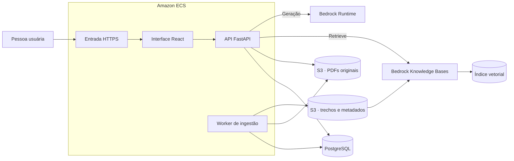

# IPBOT · Plano de arquitetura

Revisão do arquivo `arquitetura-clause.md`. A [especificação do produto](especificacao-clause.md) reúne o escopo, os comportamentos e os critérios de aceite.

## 1. Decisões técnicas

| ID | Decisão |
| --- | --- |
| D1 | React na interface, Python/FastAPI na API e PostgreSQL para dados do aplicativo. |
| D2 | **Amazon Bedrock** para acessar a LLM. O Claude Haiku 4.5 segue como modelo inicial indicado pelo documento original. Confirmar o identificador do modelo ou perfil de inferência e a disponibilidade na região da implantação. |
| D8 | Tabela de fatos com evidências para síntese, jornada, gráficos e análise de divergências. |
| D10 | Modo extrativo com busca textual no PostgreSQL como contingência para falhas na geração ou na recuperação semântica. Docker Compose serve ao desenvolvimento, aos testes locais e ao ensaio de contingência. |
| D11 | PostgreSQL mantém a referência aos originais, os metadados, as versões, as páginas, os trechos e o índice de busca textual em português. |
| D18 | **Amazon Bedrock Knowledge Bases** indexa e vetoriza os documentos e fornece recuperação semântica para o modo com IA. |
| D19 | **Amazon ECS** executa a aplicação em containers na AWS. |

A equipe confirmou acesso ao ambiente AWS. A verificação técnica cobre a região, o modelo de geração, o modelo de embeddings, o índice vetorial e as permissões das tarefas da aplicação. O desenho inicial propõe S3 como origem da Knowledge Base e armazenamento dos PDFs, OpenSearch Serverless como índice vetorial e ECS com Fargate para a execução. Esses componentes auxiliares dependem dos recursos habilitados na conta. Para o PostgreSQL, usar a instância disponível à equipe, com RDS como opção de hospedagem. [Construção de Knowledge Bases](https://docs.aws.amazon.com/bedrock/latest/userguide/knowledge-base-build.html) · [Configuração da origem S3](https://docs.aws.amazon.com/bedrock/latest/userguide/s3-data-source-connector.html)

## 2. Topologia na AWS



A API atende requisições enquanto o worker processa a fila no PostgreSQL, conforme o [ADR da ingestão](https://github.com/gabrielvictalino/hacka-ts/blob/409bc1acf945d1004cc7cea073708db9da6339f6/docs/adr/0002-fila-de-ingestao-no-postgresql.md). A proposta inicial é servir o frontend estático pelo container web da aplicação, com API na mesma origem. A interface e a API podem compartilhar o serviço ECS. O worker roda como serviço separado e processa a fila sem receber tráfego externo.

- **Armazenamento.** O bucket privado guarda os originais por versão e um prefixo separado para os trechos da Knowledge Base. A fonte de dados indexa o prefixo de trechos. A API entrega o original após validar a sessão e o vínculo com a versão citada.
- **Execução.** Publicar imagens versionadas em ECR e associá-las às definições de tarefa do ECS. Propor entrada HTTPS com um balanceador, se disponível. PostgreSQL e worker ficam em rede interna. Executar a migração antes de encaminhar tráfego à versão nova.
- **Permissões.** A role de execução permite ao ECS baixar a imagem e enviar logs. A task role da API autoriza as chamadas necessárias ao Bedrock Runtime, à Knowledge Base e aos originais. A task role do worker autoriza gravar os objetos e iniciar ou acompanhar a indexação. A role da Knowledge Base acessa o prefixo da fonte de dados, o modelo de embeddings e o índice. Usar credenciais fornecidas ao runtime por roles. [IAM para tarefas do ECS](https://docs.aws.amazon.com/AmazonECS/latest/developerguide/task-iam-roles.html)
- **Observabilidade.** Correlacionar upload, versão, job local e sincronização da Knowledge Base por identificadores. Medir consulta, extração, indexação e abertura do PDF separadamente. Manter credenciais, perguntas e conteúdo documental fora dos logs operacionais.

## 3. Ingestão, indexação e evidência

1. A Gestão envia o PDF e informa ou confirma o tema. O aplicativo pode sugerir o tema a partir do cabeçalho e dos vínculos documentais. A API guarda o original no S3 e registra versão e job. A carga inicial e o envio em lote chamam o mesmo fluxo por arquivo. Deduplicar por tema e hash conforme a [spec operacional](https://github.com/gabrielvictalino/hacka-ts/blob/409bc1acf945d1004cc7cea073708db9da6339f6/docs/spec-operacional-e-capacidade-ipbot.md).
2. O worker extrai texto por página, captura cabeçalho, item ou cláusula e grava os trechos com identificadores estáveis. A publicação da versão no PostgreSQL ocorre depois de concluir a extração. A busca extrativa consulta somente versões publicadas.
3. Para indexação semântica, a proposta é publicar uma unidade de texto por trecho paginado, com `topic_id`, `version_id`, `trecho_id` e página física em metadados. Usar objetos pequenos dentro do limite do modelo de embeddings e configurar o particionamento para preservar a correspondência com o trecho canônico. Na origem S3, os metadados podem ser enviados em arquivos associados. Testar o mapeamento com PDFs de mais de uma página e duas versões antes da carga completa. [Metadados de origem](https://docs.aws.amazon.com/bedrock/latest/userguide/kb-metadata.html)
4. O worker sincroniza a origem com a Knowledge Base e acompanha o resultado. Registrar o estado do processamento documental e o da indexação semântica separadamente. O status semântico só indica sucesso para uma versão quando a sincronização correspondente for validada. Em falhas, conservar o original e a versão extraível, expor o motivo na Gestão e repetir o envio de forma idempotente.
5. Ao substituir ou remover versões do conjunto elegível, atualizar a origem e sincronizar o índice. Durante a sincronização, a API usa o estado do PostgreSQL para decidir a elegibilidade das evidências. [Sincronização de dados](https://docs.aws.amazon.com/bedrock/latest/userguide/kb-data-source-sync-ingest.html)

### Camada A · Trechos citáveis

O worker extrai o PDF por página física e recorta por item ou cláusula dentro da página. Para texto sem essa estrutura, guarda trechos paginados. O exemplo abaixo é ilustrativo. Em execução, o campo `texto` guarda o trecho literal extraído.

```json
{
  "version_id": "versao-exemplo",
  "trecho_id": "trecho-exemplo",
  "documento": "NG_111",
  "titulo": "Férias",
  "tipo": "NG",
  "versao": "3.0.0",
  "fase": "Vigente",
  "vinculado_a": null,
  "pagina": 3,
  "item": "4.5.3",
  "texto": "Emissão do aviso pela GGC: até 35 dias antes."
}
```

A página é numerada a partir de 1 e guardada na ingestão. Versão e página identificam o original aberto pela interface.

### Camada B · Tabela de fatos (peça central)

Cada informação relevante vira um registro com categoria, área e fonte. Esta tabela alimenta perspectivas, destaques, gráficos, resumo e detecção de conflito. Cada fato referencia um trecho publicado e pode ser usado por todas as telas.

```json
{
  "id": "fato-0042",
  "categoria": "prazo",
  "assunto": "ferias",
  "area": "GGC",
  "atributo": "emissao_do_aviso",
  "descricao": "Emitir o aviso de férias",
  "valor": 35,
  "unidade": "dias antes do início",
  "trecho_id": "trecho-exemplo",
  "documento": "NG_111", "versao": "3.0.0", "pagina": 3, "item": "4.5.3",
  "trecho": "Emissão do aviso pela GGC: até 35 dias antes.",
  "vigente": true
}
```

- `categoria` ∈ **prazo, valor, obrigação, risco** (as perspectivas pedidas nos slides).
- `area` = unidade responsável (GGC, GFI, NIN, GCO, GOC, DIRAF etc.).
- `atributo` normalizado permite comparar o mesmo fato entre fontes.
- O Bedrock pode propor fatos. O backend valida o formato e a evidência, e a equipe revisa os fatos de Férias. A tabela também aceita fatos extraídos por regras ou curados pela equipe.

### Detecção de vigência, camadas e conflito (funcionalidade 7)

1. **Vigência:** vem da fase e da vigência do cabeçalho. Versões substituídas ficam marcadas e fora das respostas, mas visíveis na tela de versões.
2. **Camada:** NG > PX > FM/TB/FL. Quando um PX e uma NG dizem coisas diferentes, o sistema informa que a NG prevalece (regra do próprio acervo).
3. **Conflito:** para cada `assunto + atributo`, compara os valores entre fontes **vigentes**:
   - Mesmo valor: tudo certo.
   - Valores diferentes entre fontes de camadas diferentes: avisa a divergência e indica qual camada prevalece, **mostrando as duas fontes**.
   - Valores diferentes entre fontes de mesma camada, ou camada indefinida: marca como **conflito sem resolução** e não escolhe uma.
   - Diferença só entre versões (ex.: 30 para 45 dias): mostra como "mudou na versão", não como conflito.
4. **Viabilidade entre regras (verificação local):** além de comparar o mesmo fato entre fontes, o código cruza regras verificáveis entre si. Exemplo: um prazo de 5 dias é impossível se uma aprovação obrigatória só pode ocorrer a partir do 7º dia. Funciona com prazos, valores e faixas já estruturados na tabela de fatos, sem LLM. Não resolve expressões ambíguas nem papéis descritos de formas diferentes; isso depende da análise semântica do modo com IA.

## 4. Consulta e geração

1. A pessoa autenticada envia pergunta, tema, perspectiva e filtros. O backend resolve o conjunto elegível. A [spec do MVP](spec-ipbot.md) documenta a evolução por data de referência, incluindo histórico e planejamento.
2. No modo com IA, chamar `Retrieve` na Knowledge Base com filtro de tema. Resolver cada candidato pelo identificador do trecho no PostgreSQL e verificar tema, versão, estado e aplicabilidade. Descartar referências que não resolvam o trecho original.
3. Enviar os trechos elegíveis ao modelo via Bedrock Runtime. O modelo organiza a resposta e referencia as evidências recebidas. Prazos e valores calculados vêm das regras do backend.
4. O backend valida se cada referência existe e se sustenta a afirmação no cenário perguntado. Devolver documento, versão, página física, item ou cláusula e trecho literal. Quando faltar suporte, devolver as passagens verificáveis ou indicar a lacuna.
5. Se Knowledge Bases ou a geração estiver indisponível, usar busca textual em português no PostgreSQL. O modo extrativo retorna passagens e lacunas com o mesmo formato de evidência. Uma consulta sem evidência suficiente informa essa ausência.

O perfil da conta autoriza as operações. Todo perfil autenticado lê o mesmo acervo e abre a evidência original. Upload e alertas completos exigem o perfil `gestao`. O seletor “Ver para” só altera a apresentação. As contas de teste usam segredos geridos no ambiente de execução. O roadmap prevê integração com o diretório corporativo.

### Endpoints previstos (FastAPI)

| Método | Rota | Função |
|---|---|---|
| POST | `/documentos` | **Gestão (exige perfil `gestao`).** Upload (individual ou em lote) e disparo do processamento |
| GET | `/documentos` | Lista documentos, versões, fase, tema, relações e estados de processamento e indexação semântica |
| GET | `/api/documents/{version_id}/file` | Entrega o PDF original da versão citada após validar a sessão |
| GET | `/fatos?categoria=&assunto=&area=` | Fatos para perspectivas, filtros e gráficos |
| GET | `/assuntos/{assunto}/fluxo` | Código Mermaid do fluxograma, com ligação de cada nó à fonte |
| GET | `/conflitos?assunto=` | Divergências e mudanças de versão. Alimenta os alertas da **Gestão (exige perfil `gestao`)**; a Consulta recebe só o selo de versão e o aviso curto de divergência |
| POST | `/perguntar` | Recebe tema, pergunta, perspectiva e filtros. Devolve modo (`com_ia` ou `sem_ia`), resposta quando houver, passagens com `version_id`, documento, versão, página e trecho e a lista do que ficou sem confirmação |
| GET | `/ia/status` | Informa a disponibilidade de recuperação semântica e geração para a Consulta |
| POST | `/entrar` | E-mail e senha de um usuário de teste; devolve a sessão com o perfil (D14) |
| GET | `/eu` | Nome e perfil da pessoa que entrou; a interface usa para personalizar o guia e mostrar ou esconder a Gestão |
| POST | `/sair` | Encerra a sessão |
| POST | `/resumo-executivo` | Gera resumo a partir dos fatos escolhidos |
| POST | `/feedback` | Avaliação e comentário sobre uma resposta |
| GET | `/analises/similares?q=` | Perguntas e análises anteriores parecidas |
| POST | `/ferias/calcular` | Dada uma data de início, devolve os prazos (regras em código) |
| GET | `/saude` | Verificação de funcionamento |

As operações equivalentes já descritas na spec operacional, como `/api/documents` e `/api/questions`, podem apontar para os mesmos handlers de `/documentos` e `/perguntar`. Os formatos e as permissões são compartilhados.

## 5. Divisão do backend

| Dono | Responsabilidade | Propriedade exclusiva de arquivos |
| --- | --- | --- |
| Rafael | Fundação, Compose, banco, ingestão, carga inicial, catálogo de temas/documentos, original e sessão/permissões. Registra os roteadores na composição. | `compose.yaml`, configuração e manifesto de dependências do backend, migrações, `backend/app/main.py`, `backend/app/db/`, `backend/app/contracts/`, `backend/app/ingestao/`, `backend/app/documentos/`, `backend/app/auth/`, `backend/tests/ingestao/`, `backend/tests/acesso/` |
| Gabriel | Busca textual, consulta, evidências no resultado, fatos e síntese, regras, vigência, alertas, Bedrock e extensões de consulta. | `backend/app/consulta/`, `backend/app/fatos/`, `backend/app/regras/`, `backend/app/ia/`, `backend/app/resumo/`, `backend/app/historico/`, `backend/tests/consulta/`, `backend/tests/integracao/`, `backend/tests/capacidade/` |

- Rafael mantém os arquivos compartilhados de configuração, dependências, migrações, contrato e composição. Gabriel envia o formato ou a dependência de que precisa. Rafael incorpora a mudança compartilhada no PR de fundação ou em commit próprio. A regra também vale para arquivos raiz de testes, se necessários.
- Rafael testa o acesso direto a arquivo, papéis e operações de Gestão. Gabriel testa a consulta e os alertas usando o guard de sessão e perfil mantido por Rafael. Cada dono mantém suas fixtures e testes. Gabriel reúne os resultados de integração e carga do backend. Ajustes da CI ficam com o dono da configuração de CI da equipe, pela #16.
- Os caminhos são uma proposta de organização por módulo. A dupla pode adaptar os nomes no PR de fundação, mantendo um dono por arquivo.

Rafael também mantém os recursos de deploy em `infra/`, a publicação dos trechos no S3 e a sincronização da Knowledge Base. Gabriel mantém a recuperação pela API `Retrieve`, a resolução das citações, a geração pelo Bedrock e o fallback extrativo. Ambos implementam contra o contrato `topic_id` + `version_id` + `trecho_id` + página física. Gabriel pode simular a resposta da Knowledge Base enquanto Rafael provisiona a origem e testa a sincronização.

## 6. Validação inicial no ambiente AWS

- **Recuperação.** Com um PDF sintético, validar upload, extração, publicação, sincronização e `Retrieve`. Repetir com segunda versão e provar que a citação abre o PDF correto na página registrada.
- **Geração.** Usar a task role da API para testar tanto `Retrieve` quanto a chamada ao modelo. Registrar região, modelo, índice e resultado. Uma chamada bem-sucedida no Kiro comprova a identidade do Kiro. O teste dentro da task comprova a identidade da aplicação.
- **Implantação.** Verificar inicialização da API e do worker no ECS, acesso ao banco, persistência do original entre reinícios, processamento da fila e abertura da fonte por HTTPS. Testar a consulta extrativa com Bedrock ou Knowledge Bases indisponível. Registrar impedimentos específicos da conta, se houver.

## 7. Cronograma de integração

Horários aproximados, ajustar à hora real. Fim às 07h30.

| Bloco | Objetivo | Entregável |
|---|---|---|
| 1 (até ~14h) | Confirmar região, permissões de ECS, Bedrock e Knowledge Bases. Subir Compose, definir contratos e validar um PDF sintético | Primeira migração e prova com sincronização e recuperação em Knowledge Bases |
| 2 (~14h-18h) | Upload, worker, armazenamento e indexação. Integrar `Retrieve`, geração Bedrock, validação e modo extrativo | Upload → indexação → pergunta → evidência, com teste de contingência extrativa |
| 3 (~18h-22h) | Publicar API e worker no ECS. Integrar perspectivas, fatos e vigência com a interface | Fluxo principal na AWS e teste de abertura da fonte |
| 4 (~22h-02h) | Detector de conflitos; Locação enxuto; bateria de perguntas armadilha; teste com 100 usuários simultâneos; resumo executivo e feedback (nível 2) | Núcleo funcional, divergências verificadas e medição de carga registrada. Nível 2 se couber |
| 5 (~02h-05h) | Polimento visual, revezamento de descanso, ensaio do pitch | Demo estável; pitch e plano de 6 meses prontos |
| 6 (~05h-07h30) | Congelar código, entrega à BBTS, ensaio final | Entrega feita |

Regra: não começar funcionalidade nova depois do bloco 4.

## 8. Riscos

| Risco | Mitigação |
|---|---|
| Escopo grande demais (8 funcionalidades) | Priorização em níveis; congelar escopo após o bloco 4; justificar no pitch |
| Alucinação da LLM | Prompt restritivo, validador de citações, resposta "não consta" |
| Número errado em gráfico | Fatos revisados por humano (Férias), cálculos em código |
| Conflito "inventado" ou falso positivo | Só comparar `atributo` normalizado entre fontes vigentes; mostrar sempre as duas fontes |
| Upload com documentos fora do padrão | Regras para o padrão do acervo; LLM só como apoio; usuário confirma |
| Falha de Knowledge Bases ou geração Bedrock | Busca extrativa no PostgreSQL para versões publicadas e aviso na interface. A Gestão acompanha o estado de indexação e o worker tenta novamente quando aplicável |
| Acesso insuficiente na task do ECS | Validar IAM e conectividade a partir da task e registrar o bloqueio específico. Compose serve para desenvolvimento e contingência de apresentação |
| Modo sem IA com interpretação mais pobre | Mostrar as passagens com destaque; regras verificáveis em código; deixar claro na tela qual modo está ativo |
| PostgreSQL não instalado a tempo | Preparar e validar a instalação e a conexão no início do trabalho; registrar e resolver bloqueios mantendo PostgreSQL como banco definido (D1, D11) |
| Fadiga na madrugada | MVP até ~22h, revezamento de descanso, sem funcionalidade nova após o bloco 4 |
| Tabelas e fluxograma mal extraídos | Conferir manualmente TB e FL (o FL já vem como código Mermaid) |
| Vazamento dos documentos | Não subir os PDFs em repositório público; colocar `ferias/`, `inovacao/`, `locacao/` e o catálogo no `.gitignore` |
| Gestão aberta a qualquer pessoa | Sessão com perfil verificada no back-end; só o perfil `gestao` acessa upload e alertas (D14) |
| Usuários de teste passarem por segurança real | Dizer isso na tela de entrada e no pitch; credenciais fora do repositório; conta da empresa na evolução |
| Custos de indexação e execução AWS | Confirmar os recursos cobertos pelo ambiente. Controlar chamadas, processar reenvios sem duplicação e acompanhar o uso de embeddings, índice e execução |

## 9. Validação de capacidade e acesso

### Cenário de carga

- Executar o teste com **PostgreSQL real** e o modo **sem IA (extrativo)** como referência. Medições com IA têm resultados separados.
- Preparar os três temas e perguntas conhecidas. Usar PDFs sintéticos de tamanhos variados, incluindo arquivos próximos de 100 páginas e pelo menos um maior.
- Aumentar a carga em patamares de **25, 50 e 100 usuários virtuais simultâneos**. Cada usuário representa uma sessão autenticada que consulta, pausa para leitura e abre fontes em parte das interações. Usar pausas de 5 a 15 segundos e abertura de PDF em cerca de um terço das interações, registrando os parâmetros efetivos.
- Repetir o patamar de 100 usuários durante a ingestão de novos PDFs. Registrar o intervalo em que consultas e processamento se sobrepõem.

### Critérios e registro

- **Latência de consulta extrativa:** p95 de até **2 segundos** com 100 usuários simultâneos durante ingestão.
- **Erros inesperados:** menos de **1%** das operações. Contar timeouts, falhas de conexão, respostas 5xx e resultados que não passem nas verificações esperadas; registrar contagem e denominador.
- Medir abertura de PDF separadamente e verificar que a citação continua apontando para o documento, a versão, a página e o trecho corretos.
- Registrar duração, requisições por segundo, CPU, RAM, versão do código, volume do acervo, concorrência de processamento e tempos de fila e ingestão.
- Anexar a saída da ferramenta de carga ao registro da execução. Se uma meta não for atingida, registrar o resultado, a limitação e o maior patamar concluído. **As metas só podem ser declaradas atingidas após medição.**

### Verificação de acesso

- Validar que os perfis `empregado`, `gestor` e `gestao` conseguem listar, pesquisar e abrir os mesmos documentos e suas citações, inclusive pelo identificador direto do PDF.
- Validar que chamadas sem sessão aos documentos e às consultas são recusadas.
- Validar que somente `gestao` consegue executar uploads e acessar os alertas completos. Alterar o seletor "Ver para" não concede essas permissões.

O cenário extrativo é a referência para as metas. Medir também, quando disponível, latência de `Retrieve`, geração e tempo entre a publicação do trecho e a confirmação da indexação semântica. Identificar o ambiente e a revisão da aplicação em cada execução.
